# Gatewright Pipeline

**A self-hosted DevSecOps pipeline for your own laptop or server.** Source-available, free for noncommercial use.
Run Dev, Sec and Ops checks through gates, get plain-language errors with the failing code
line marked in red, and get a verifiable artifact for every run. No cloud and no CI credits.

```
$ gatewright run
▶ Run 20261122-074136-559f  commit f7edae20  profile laptop  (max 1 parallel)
──────────── gate commit (enforced) — 5 job(s) ────────────
  ✗ FAIL lint 0.2s — 5 issue(s)
  ✓ PASS format 0.2s
  – SKIP secrets-scan (optional tool `gitleaks` not installed)
  ✗ FAIL sast 0.2s — 3 issue(s)
  ✗ policy: Policy `no-high-in-commit` FAILED: findings.high is 1, required == 0.
──────────── gate build (enforced) — 1 job(s) ────────────
  ⏸ BLOCKED compile (enforced gate `commit` failed)

╭─ sast ──────────────────────────────────────────────────────────────────────╮
│  HIGH   CODE · finding · bandit B602  app/config.py:9                         │
│ A subprocess is started with shell=True in `app/config.py` line 9. If any    │
│ argument contains user input, it can be used to inject shell commands.      │
│ How to fix: Pass the command as a list and drop shell=True.                 │
│   8 def run(cmd):                                                           │
│ ❱ 9     return subprocess.run(cmd, shell=True)          ← shown in red      │
╰─────────────────────────────────────────────────────────────────────────────╯
```

> **Status: 0.7 (beta).** Tested for real on nine Linux distributions and one Windows 11 machine, and with real GitHub,
> Gitea, Forgejo and GitLab. On macOS the test suite passed for 0.7.1 (a GitHub-hosted
> runner); nobody has used it there yet, and it is not part of CI.
> See the [known issues map](docs/known-issues.md) before relying on it.

## Contents

- [What it is](#what-it-is) · [How it works](#how-it-works) · [Features](#features)
- **[Operating Gatewright](#operating-gatewright)**: install, set up, run, read results, local builds, git, releases
- **[Execution in the TUI](#execution-in-the-tui)** and **[in the CLI](#execution-in-the-cli)**, with screenshots of real runs and [all commands](#all-commands)
- [Documentation](#documentation) · [Branches](#branches) · [Requirements](#requirements) · [Contributing](#contributing)

## What it is

Gatewright checks software before it ships, on a machine you own. You describe the checks in YAML; Gatewright runs
them in order, explains every problem in plain language, and leaves a verifiable record of what was tested.

| Area | Asks | Typical jobs |
|---|---|---|
| **Dev** | Does it work? | lint, compile, unit tests, coverage |
| **Sec** | Is it safe? | secret scan, code scan (SAST), vulnerable dependencies, image scan |
| **Ops** | Can it be shipped and run? | packaging, install smoke test, deploy, health check |

It exists because hosted pipelines cost credits and run elsewhere. Nothing here needs a cloud account. The whole story,
the design decisions and the roadmap: [docs/project.md](docs/project.md).

## How it works

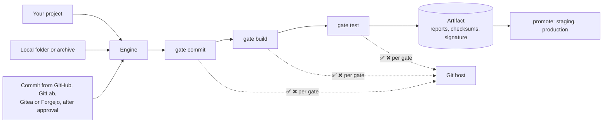

Jobs are YAML files in `.gatewright/jobs/`. Each one has a command, a gate, a category, a parser and a
resource cost. The **engine** runs gates in order. Inside a gate, the **scheduler** starts jobs when their
dependencies are done and the machine has room. The **runner** executes each command (in your shell or
a container), streams its log, and a **parser** turns the tool's output into structured errors with
explanations. Policies, baselines and caching are applied, then reports, manifest, checksums and
history are written. The CLI and the TUI are both thin front-ends over the same engine.
Details: [architecture.md](docs/architecture.md).

## Features

- **Local builds:** test any folder, archive or file on your computer, no git host needed (`o` in the TUI).

- **Gates you choose:** commit → build → test → staging, each *enforced* (blocks later gates) or
  *advisory* (records and continues). Run all of them, one gate, one category (dev/sec/ops) or one job.
- **Human errors:** every finding gets a plain-language explanation, a fix, and the code with the
  failing line in red, in the terminal, the TUI and the reports. Your code's problems (red) are
  kept separate from tooling problems (orange: tool missing, timeout, out of memory...).
- **Protects the machine:** hardware detection, laptop/server profiles, jobs start only when CPU/RAM
  allow, and a watchdog stops runaway jobs before the system freezes.
- **Artifacts:** each run produces logs, reports (Markdown per gate, HTML, PDF, SARIF, JUnit), a
  manifest of what was tested on which commit with which tool versions, SHA-256 checksums, and a `.tar.gz`.
- **Day-to-day tools:** dry run, `rerun-failed`, caching, run history and diffs ("2 new findings since
  last run"), baselines with reason + expiry, policy as code ("no critical findings"), your own
  minimum test coverage per gate and for the whole run (`coverage: 80`, `--coverage test=90`),
  secrets masked everywhere, `doctor` with install commands for your OS.
- **Terminal UI:** pick gates, run, watch live logs and CPU/RAM, browse errors and reports.
- **Git integration:** watches GitHub, Gitea, Forgejo or GitLab. Commits wait in an approval queue,
  run pinned to their exact SHA, and get ✅/❌ per gate plus a pull request summary. Pull requests from
  forks run without secrets and with your job definitions. Includes a pre-push hook.
- **Trust and release:** artifacts signed with SSH keys (`ssh-keygen`, nothing extra to install),
  environments with promote / approval / health check / automatic rollback, deployment history,
  release notes from your commits.
- **Notifications:** ntfy, any webhook (Slack, Mattermost, Discord), e-mail, Matrix.
- **Containers optional:** any job can run in a container with hard CPU/RAM limits and no network.
- **Runs anywhere Python runs:** a distro-aware installer for Kali, Debian, Ubuntu, Fedora, RHEL, Arch,
  openSUSE, Alpine, Void, Gentoo, NixOS and macOS. `install.ps1` for Windows.

## Operating Gatewright

The complete guide is [docs/operating.md](docs/operating.md). In short:

### 1. Install

```bash
git clone https://github.com/TheSamuelAttilaZemes/GateWright-DevSecOps-Pipeline.git gatewright && cd gatewright
sh install.sh                                                  # Linux, macOS
# or from PyPI, on any system: pipx install "gatewright-pipeline[tools]"
powershell -ExecutionPolicy Bypass -File install.ps1           # Windows (Python 3.10+, Git for Windows)
gatewright doctor                                              # what is missing, and how to install it here
```

### 2. Set up a project

```bash
cd your-project
gatewright init                  # starter pipeline for Python, Node or Docker
gatewright run --dry-run         # what would run, in what order
```

### 3. Run it

`gatewright tui` opens the terminal UI, `gatewright run` does the same on the command line.

| Key | Does | Key | Does |
|---|---|---|---|
| `r` | run | `o` | open a build on this computer |
| `d` | dry run | `e` `l` `p` `u` | errors, log, report, queue |
| `f` | re-run what failed | `a` / `n` | approve / reject a commit |
| `x` | cancel | `m` | stop at failing gates, or only record |
| `space` | gate on/off | `q` | quit |

### 4. Read the result

| Status | Means |
|---|---|
| `passed` / `warn` | fine / fine, with findings below your limit |
| `failed` | **your code** has a problem: the error says what, where and how to fix it |
| `error` | **the machine or a tool** has a problem |
| `blocked` | an earlier gate failed |

`gatewright show` repeats the errors, `gatewright diff` shows what is new, and `.gatewright/runs/<run>/report.html` is
the full report.

### 5. Test a build on your computer

Press `o` and paste a path (or `ctrl+o` for the file dialog), or:

```bash
gatewright run --local /path/to/build.zip
```

This runs the build's code as you, without your secrets. Open only what you trust that far.

### 6. Follow your git host

```bash
export GATEWRIGHT_SECRET_VCS_TOKEN=...   # and a vcs: section in pipeline.yml
gatewright watch                         # commits wait in the queue, nothing runs by itself
gatewright queue && gatewright approve 1 # runs exactly that commit, reports ✅/❌ per gate
```

### 7. Release

```bash
gatewright promote --to staging          # the tested artifact, with health check and rollback
gatewright rollback staging
```

## Execution in the TUI

Every picture here is a screenshot of a real run on Windows 11, not a mock-up: the same small project
(a temperature converter) once working, once **broken on purpose** (an unused import, a shell injection, a missing
`VERSION` file), first from a local folder, then from a private GitHub repository (its name and account are covered in grey).

```bash
gatewright tui          # in a project: its pipeline. Anywhere else: it asks what to test
```

**Layout:** gates and categories to switch on or off, and the machine's load (left); jobs (top right); errors, log,
report, history and queue (bottom right). The keys are in the bottom line and in
[Operating Gatewright](#3-run-it).

### Local: open a build

Press `o`. Type or paste the full path, pick a folder, or use `ctrl+o` / `ctrl+f` for the desktop's dialog. Enter opens it.

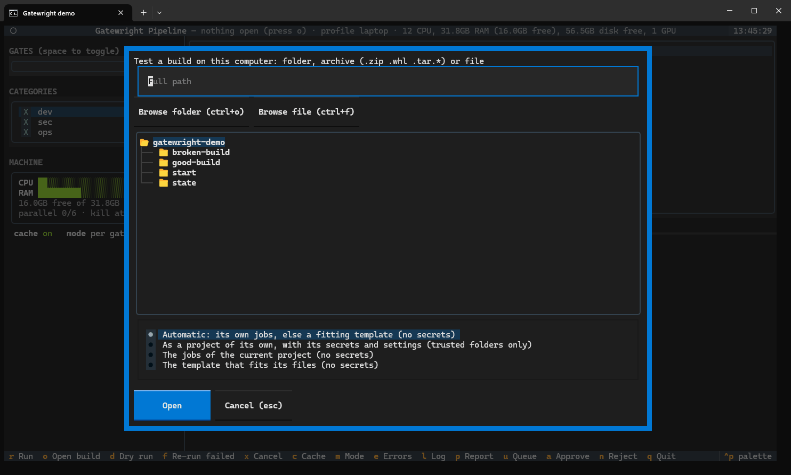

Press `r`. The Log tab follows the jobs while they run:

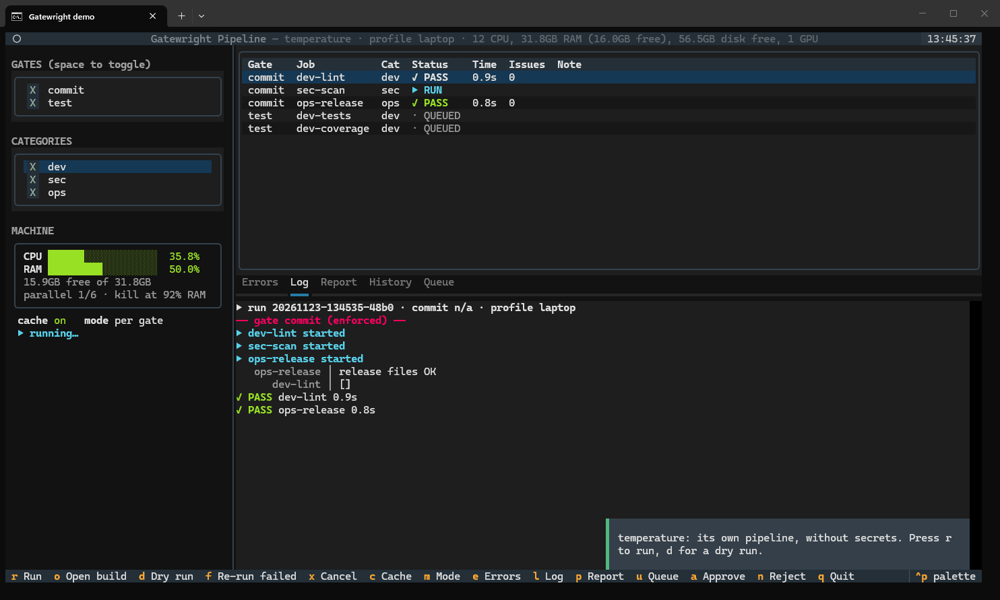

### Local: good run

All gates pass, in Dev, Sec and Ops:

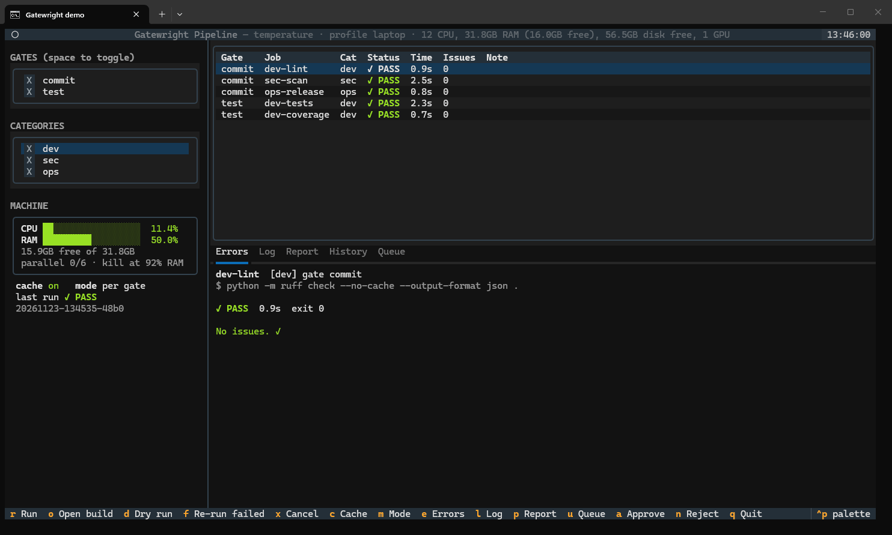

### Local: bad run

The `commit` gate fails, so the `test` gate is **blocked**. Select a job with `↑` `↓`: the Errors tab says what is wrong,
how to fix it, and marks the line.

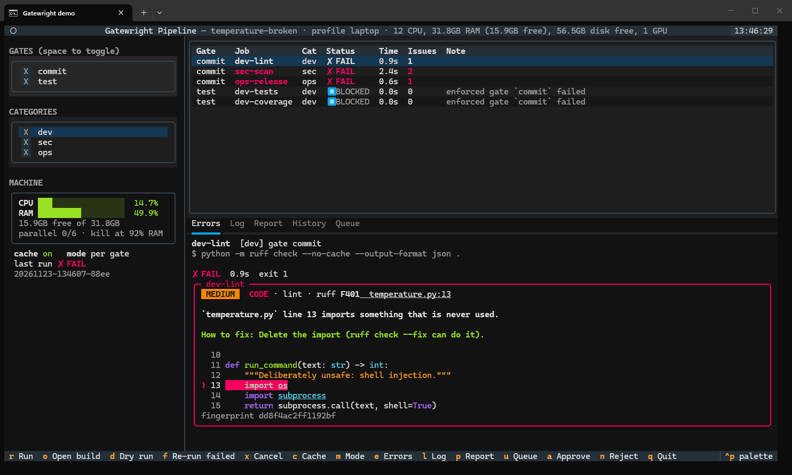

### Git: good run

`gatewright watch` fetched the commit from GitHub. It ran after it was approved in the Queue tab:

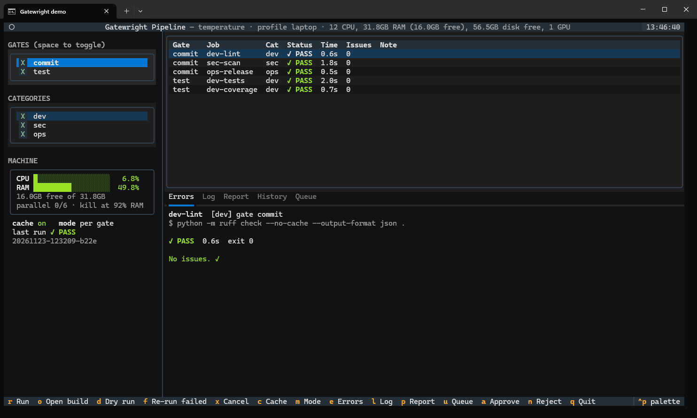

### Git: bad run

A pull request that is broken on purpose. It was approved, tested and rejected by the `commit` gate:

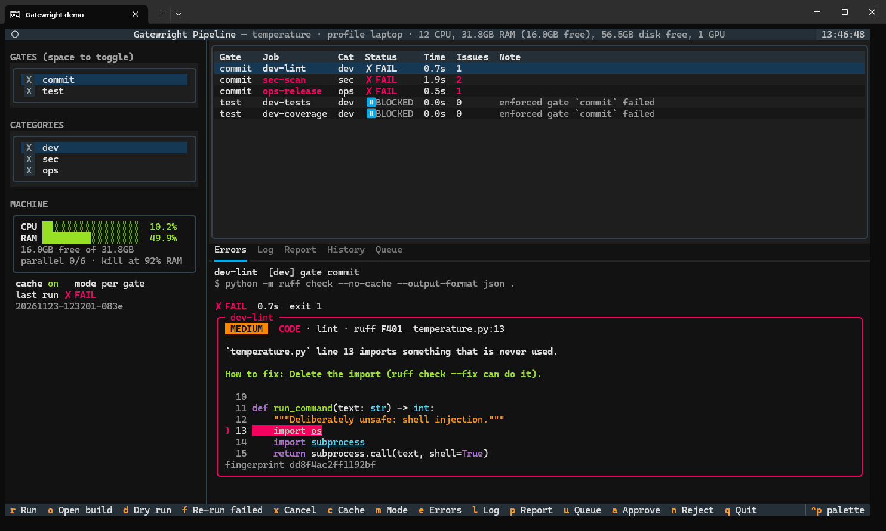

The Queue tab (`u`) after both. `a` approves the highlighted commit, `n` rejects it:

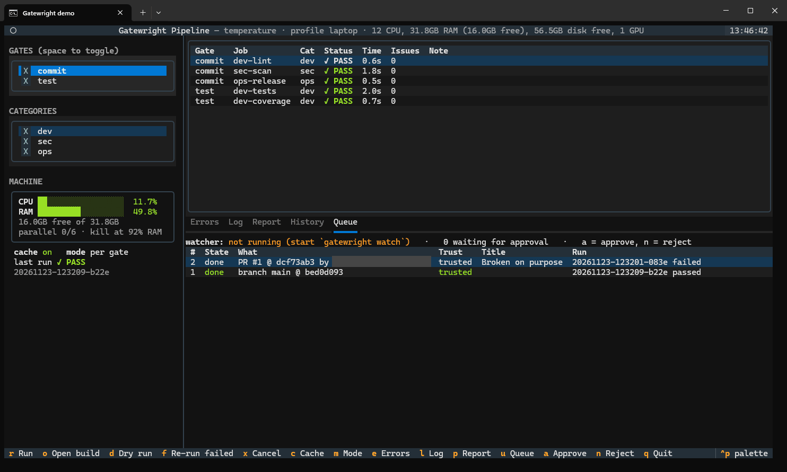


## Execution in the CLI

The same runs on the command line. Exit code `0` is passed, `1` failed, so it works in scripts and hooks.

### Local: good run

```bash
gatewright run --local good-build
```

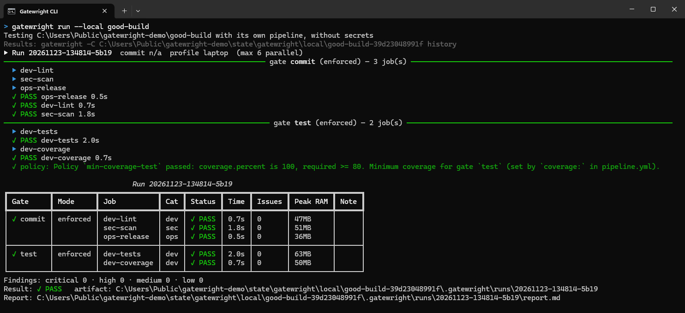

### Local: bad run

```bash
gatewright run --local broken-build -q       # -q: only the summary
```

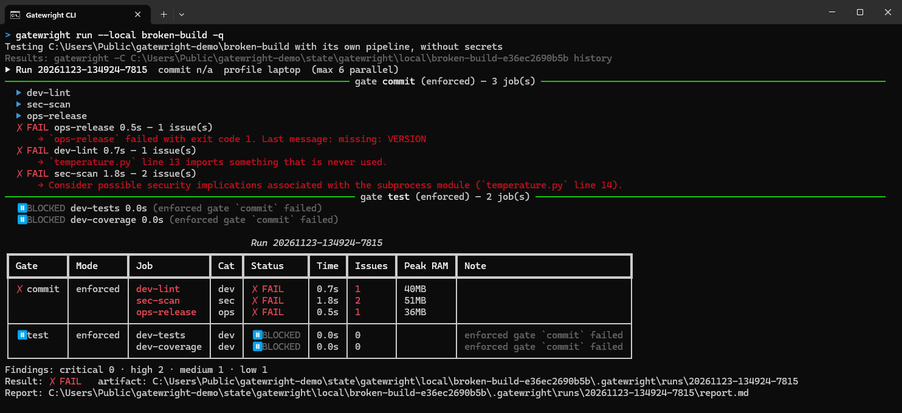

Without `-q` every problem is explained:

```bash
gatewright run --local broken-build
```

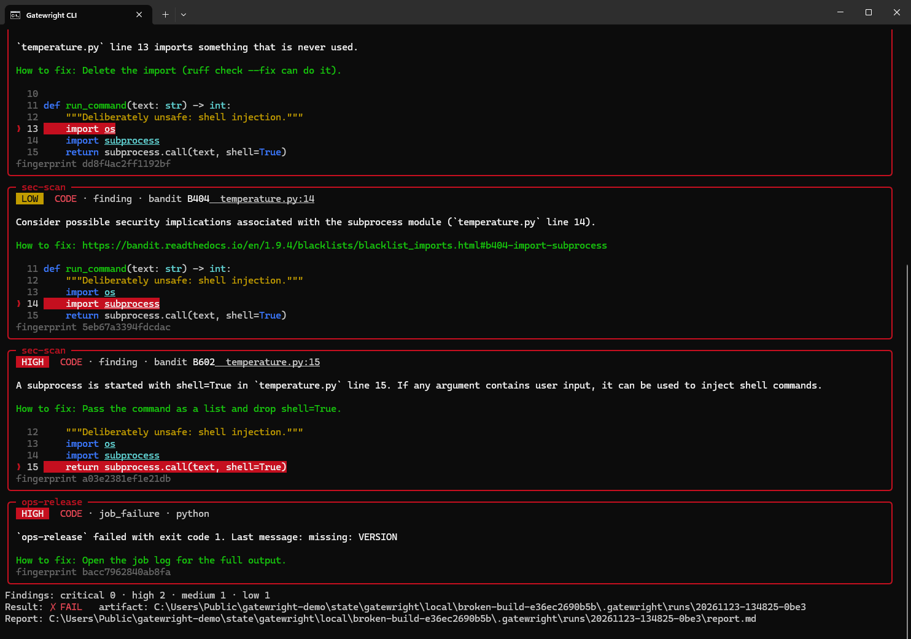

### Git: good run

```bash
gatewright watch             # in one terminal: follows the git host
gatewright queue             # in another: what is waiting
gatewright approve 1         # runs exactly that commit
```

Afterwards the queue, the history, and what GitHub itself says about the commit:

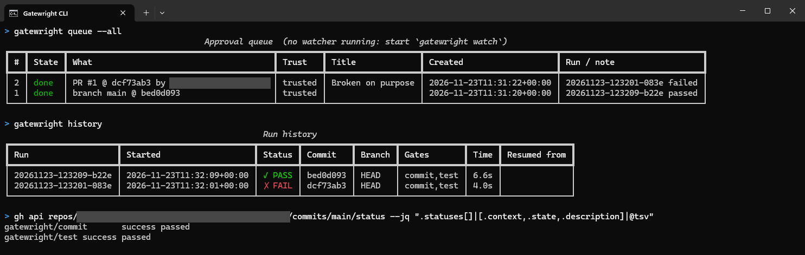

### Git: bad run

The comment Gatewright left on the broken pull request, read back from GitHub:

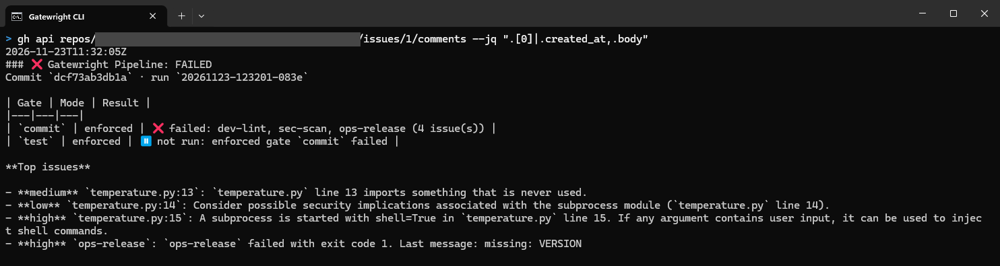

### All commands

`gatewright <command> --help` shows the details. `-C DIR` before the command works on another project
(`gatewright -C ~/app run`); `gatewright --version` prints the version.

**Set up**

| Command | Does | Options |
|---|---|---|
| `gatewright init` | Write a starter pipeline | `--template python\|node\|docker`, `--force` |
| `gatewright validate` | Check the configuration, name every problem | |
| `gatewright doctor` | What is missing on this machine, and how to install it | |
| `gatewright hw` | Detected hardware and the resource budget | `--json` |

**Run**

| Command | Does | Options |
|---|---|---|
| `gatewright run` | Run the pipeline | `-g GATES`, `-c dev,sec,ops`, `-j JOBS`, `--mode enforced\|advisory`, `--coverage [GATE=]N`, `--no-cache`, `--report md,html,pdf,sarif,junit`, `-v`, `-q`, `--dry-run`, `--local PATH`, `--pipeline auto\|own\|project\|template` |
| `gatewright plan` | What would run (the same as `run --dry-run`) | like `run` |
| `gatewright rerun-failed [RUN]` | Re-run only what failed (also: `resume`) | `-v` |
| `gatewright tui` | Terminal UI | `--local [PATH]`, `--pipeline ...` |

**Results**

| Command | Does | Options |
|---|---|---|
| `gatewright history` | Earlier runs | `-n N` |
| `gatewright show [RUN]` | Errors of a run, with code | `--job JOB`, `--all` |
| `gatewright diff [OLD] [NEW]` | New and fixed findings between two runs | |
| `gatewright report [RUN]` | Make reports again | `-f md,html,pdf,sarif,junit`, `-o DIR` |
| `gatewright baseline create [RUN]` | Accept the current findings, with a reason and an end date | `--reason TEXT`, `--days N` |
| `gatewright baseline list` | What is accepted | |
| `gatewright verify [RUN]` | Prove that an artifact was not changed | `--require-signature` |
| `gatewright cache-clear` | Forget cached job results | |
| `gatewright clean` | Delete the files of old runs, never of deployed ones | `--keep N`, `--days N`, `--dry-run` |

**Git**

| Command | Does | Options |
|---|---|---|
| `gatewright watch` | Follow the git host, queue commits, run approved ones | `--once` |
| `gatewright queue` | The approval queue | `--all`, `-n N` |
| `gatewright approve ID` | Run that exact commit | `--by NAME` |
| `gatewright reject ID` | Never run it | `--reason TEXT`, `--by NAME` |
| `gatewright hook install` | Run a gate before every `git push` (`uninstall`, `status`) | `-g GATES`, `--force` |

**Release**

| Command | Does | Options |
|---|---|---|
| `gatewright keygen` | Create a signing key | `--identity WHO`, `--key PATH`, `--add`, `--passphrase` |
| `gatewright sign [RUN]` | Sign an artifact | |
| `gatewright promote [RUN]` | Deploy a tested artifact | `--to ENV`, `-y` |
| `gatewright rollback ENV` | Redeploy the one before, or a given run | `--to RUN`, `-y` |
| `gatewright deployments [ENV]` | What is live, and the history | `-n N` |
| `gatewright release-notes` | Notes from commits and a run | `--from REF`, `--to REF`, `--run RUN`, `--title TEXT`, `-o FILE` |
| `gatewright notify-test` | Send a test message to every channel | |

## Documentation

| | |
|---|---|
| **[Operating Gatewright](docs/operating.md)** | Daily use, from installing to rolling back |
| [The project](docs/project.md) | Why it exists, timeline, design decisions, roadmap, gotchas |
| [Getting started](docs/getting-started.md) | Install, first pipeline, everyday commands, TUI keys |
| [Configuration](docs/configuration.md) | Every option of `pipeline.yml` and job files |
| [Errors, reports, artifacts](docs/errors-and-reports.md) | How errors are explained, baselines, report formats, what to do with artifacts |
| [Resources](docs/resources.md) | How Gatewright keeps your machine responsive |
| [Git integration](docs/git-integration.md) | Watch your git host, approvals, statuses per gate, pre-push hook |
| [Releases](docs/releases.md) | Signing, environments, promote, rollback, release notes |
| [Notifications](docs/notifications.md) | ntfy, webhook, e-mail, Matrix |
| [Tips](docs/tips.md) | Services, webhooks at home, Kali, a fully self-hosted setup |
| [Windows](docs/windows.md) | Windows support and its known issues |
| [Troubleshooting](docs/troubleshooting.md) | Symptoms → causes → fixes |
| [Known issues](docs/known-issues.md) | What's untested or limited |
| [Architecture](docs/architecture.md) | How the code fits together (with diagrams) |
| [Extending](docs/extending.md) | Add a tool, report format, command, template or Linux distribution |
| [Testing](docs/testing.md) | Running and writing tests |

## Branches

| Branch | For | Changes arrive |
|---|---|---|
| `main` | The working, released source. Always installable | from `development` by pull request, when CI is green |
| `development` | Daily work | from your pull requests |

More in [CONTRIBUTING.md](CONTRIBUTING.md#branches).

## Requirements

- Python 3.10+ (installed for you by `install.sh` where possible)
- Optional: git (commit tracking), Docker (container jobs), Pango (PDF reports), and the tools your
  jobs call (the installer adds ruff, bandit, pytest, coverage and pip-audit)

## Contributing

Contributions are welcome, especially real-world test reports on Windows, macOS and other Linux
distributions, new tool parsers, and friendlier error explanations. See [CONTRIBUTING.md](CONTRIBUTING.md).

## Credits

Created by Samuel Attila Zemes. Built with the help of Claude (Anthropic).

## License

Copyright (C) 2026 Samuel Attila Zemes. [PolyForm Noncommercial License 1.0.0](LICENSE.md), see also [NOTICE](NOTICE).
Gatewright is **source-available, free for noncommercial use**. In short, and without replacing the license:

| Who | May use Gatewright |
|---|---|
| You privately: hobby, study, research, your own projects without commercial intent | Yes, free: use, change and share it |
| Schools, charities, public research, public safety, health and environmental organisations, government | Yes, free |
| Companies and freelancers, for commercial work | Only [with permission](COMMERCIAL.md) |

- Passing it on: include the license and the Required Notice from [NOTICE](NOTICE).
- What Gatewright writes for you (starter files, hooks, reports, artifacts) is yours.
- There is no warranty.
