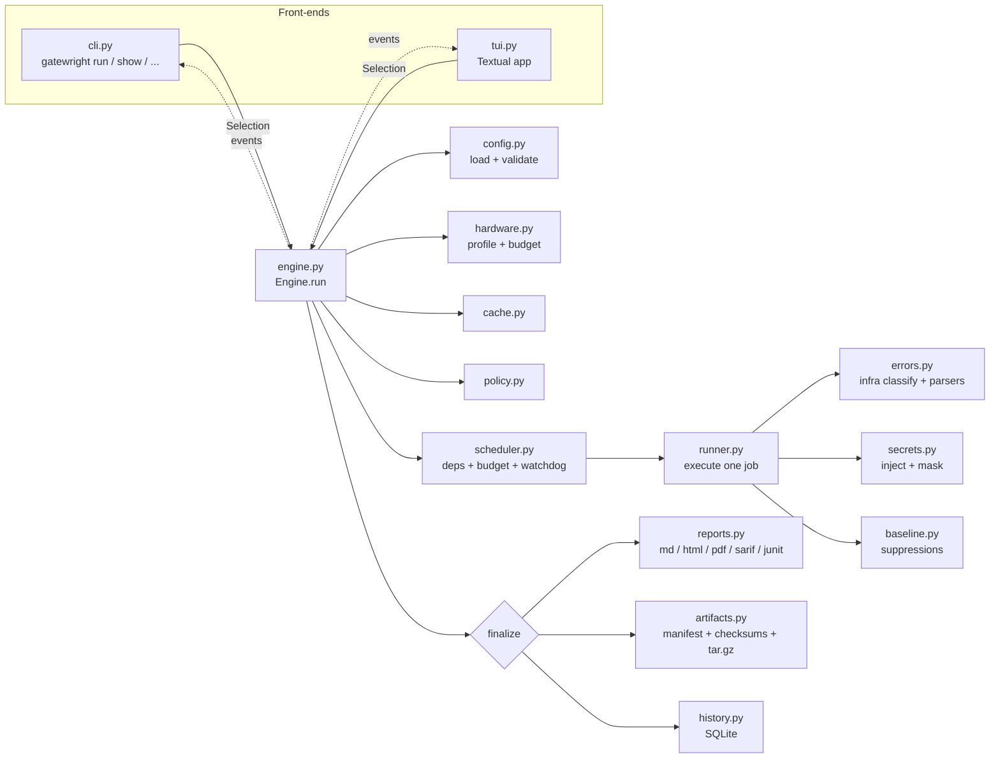
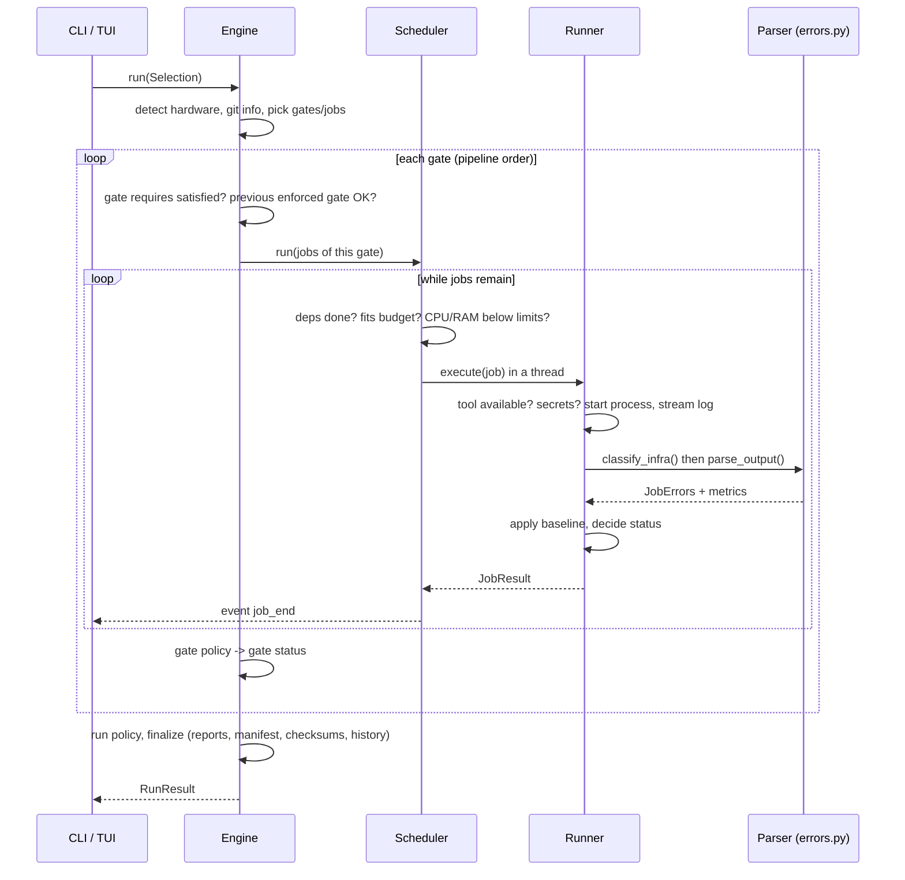

# Architecture

This page explains how Gatewright is put together, so you can change it with confidence.
Every module also starts with a docstring explaining its role. Read those next to this page.

## Design rules

1. **One engine, many front-ends.** The CLI (`cli.py`) and the terminal UI (`tui.py`) never run jobs
   themselves. They build a `Selection` and call `Engine.run()`. A future web UI, git trigger or chat
   bot does the same, and behaviour stays identical everywhere.
2. **Every result is structured data.** Jobs produce `JobResult`s containing `JobError`s, never just
   text. Reports, the TUI, SARIF/JUnit exports and the history all read the same objects.
3. **Code problems and infrastructure problems are different things.** "Your test failed" (CODE, red)
   and "pytest isn't installed" (INFRA, orange) are classified separately, so nobody chases the wrong problem.
4. **Never take the machine down.** Jobs declare a cost, the scheduler respects a budget, and a
   watchdog stops runaway jobs.
5. **A run always produces an artifact.** It does so even when jobs fail, crash or are cancelled.
6. **No hidden state.** Everything lives in the project's `.gatewright/` folder: config, cache, history, runs.

## The big picture



## Lifecycle of a run



## Module map

| Module | Responsibility | Read it when you want to... |
|---|---|---|
| `models.py` | Data classes: `Pipeline`, `Gate`, `Job`, `PolicyRule`, `RunResult`, `GateResult`, `JobResult`, `JobError` | understand any data that flows around |
| `config.py` | Load `.gatewright/pipeline.yml` + `.gatewright/jobs/*.yml`, schema + semantic validation, friendly errors | add a config option |
| `schema_check.py` | Tiny JSON-Schema validator (no compiled dependencies) | support a new schema keyword |
| `graph.py` | Topological sort, cycle detection, parallel waves | change dependency logic |
| `engine.py` | Orchestration of a run; gates, `requires`, cache/reuse, finalize | change what a run does |
| `scheduler.py` | Start jobs when deps + budget allow; memory watchdog; cancel | change parallelism / resource rules |
| `runner.py` | Run one job: shell/docker command, PATH, env, streaming, timeout, retries, kill tree | support a new runtime, shell or OS quirk |
| `errors.py` | Infra classification, tool parsers, rule catalog, snippets, fingerprints | **add support for a new tool** |
| `policy.py` | Metrics and policy rules | add a metric |
| `baseline.py` | Suppressions with reason + expiry | change suppression matching |
| `cache.py` | Cache keys and stored results | tune caching |
| `history.py` | SQLite history and run diffs | add queries / trends |
| `artifacts.py` | Manifest, outputs, checksums, tar.gz, verify | change the artifact format |
| `reports.py` | Markdown/HTML/PDF/SARIF/JUnit | **add a report format** |
| `render.py` | Rich renderables shared by CLI + TUI (status, red code snippets) | change how errors look in the terminal |
| `hardware.py` | Hardware detection, laptop/server profile, budget | change resource policy |
| `platform_info.py` | OS/distro detection, install hints | **add a Linux distribution** |
| `secrets.py` | Secret lookup and masking | add a secret backend (Vault, pass, ...) |
| `doctor.py` | `gatewright doctor` checks | add a check |
| `templates.py` | `gatewright init` templates | **add a project template** |
| `cli.py` | argparse commands | **add a command** |
| `tui.py` | Textual app | change the terminal UI |
| `install.sh` | Distro-aware installer (POSIX sh) | support a new distro in the installer |
| `vcs/` | Git host adapters: `base.py` (interface, HTTP client with ETags), `github.py`, `gitea.py` (also Forgejo), `gitlab.py` | **add a git host** |
| `queue.py` | Approval queue and watcher state in SQLite | change approval states |
| `watch.py` | The watcher: trust rules, polling, webhook server, SHA-pinned checkout, per-gate statuses, PR comments | change how commits are picked up and run |
| `hooks.py` | git pre-push hook install/uninstall | change the hook |
| `signing.py` | SSH signatures over `checksums.sha256` (`ssh-keygen -Y`) | change signing |
| `deploy.py` | Environments, promote, verify, auto-rollback, deployment history | change release rules |
| `releasenotes.py` | Release notes from git + run quality | change the notes format |
| `notify.py` | ntfy, webhook, e-mail, Matrix notifications | **add a notification channel** |

## Data on disk

```
your-project/
  .gatewright/
    pipeline.yml          gates, profile, limits, policy          (commit this)
    jobs/*.yml            job definitions                          (commit this)
    baseline.yml          accepted findings                        (commit this)
    secrets.env           local secrets                            (never commit)
    cache/<job>.json      cached passing results                   (ignored)
    gatewright.db              SQLite run history                       (ignored)
    runs/<run-id>/        one artifact folder per run              (ignored)
      manifest.json         the full RunResult + Gatewright version
      logs/<job>.log        secret-masked output
      out/<job>/            files written to $GATEWRIGHT_OUT + declared outputs
      report.md, gate-*.md, report.html, report.pdf, results.sarif, junit.xml
      checksums.sha256      SHA-256 of every file above
    runs/gatewright-run-<run-id>.tar.gz
    allowed_signers       public keys whose signatures you trust    (commit this)
    workspaces/<id>-<sha>/  temporary checkout of a queued commit   (deleted after the run)
    deployments/<id>-<env>/ deploy.log, verify.log, release-notes.md, deployment.json
```

`gatewright.db` holds four tables: `runs`, `issues` and `gate_results` (history), `queue` and
`vcs_state` (approval queue, poll ETags, watcher heartbeat), and `deployments`.

## Statuses

| Job status | Meaning | Counts as OK for dependants? |
|---|---|---|
| `passed` | Exit 0, or every finding suppressed | yes |
| `warn` | Only findings below the job's `fail_on` | yes |
| `failed` | Code problem: findings/test failures at or above `fail_on` | no |
| `error` | Infra problem: tool missing, timeout, out of memory, crash, missing secret | no |
| `blocked` | A dependency failed, or an earlier enforced gate failed | no |
| `skipped` | Optional tool missing, cancelled, or not selected | yes |
| `cached` | Inputs unchanged since a passing run | yes |
| `reused` | Taken from the run being resumed (`rerun-failed`) | yes |

A **gate** is `failed` if any job is failed/error/blocked or a gate policy rule fails. An *enforced*
failed gate blocks all later gates. The **run** is `failed` if an enforced gate failed or a run-level
policy failed, and `warn` if only advisory gates failed or jobs warned.

## Events

`Engine(pipeline, on_event=callback)` calls `callback(kind, data)` from worker threads:

| kind | data |
|---|---|
| `run_start` | `run` (RunResult, empty), `budget`, `gates`, `jobs` (gate → job ids) |
| `gate_start` | `gate`, `mode`, `jobs` |
| `job_start` | `job_id` |
| `job_waiting` | `job_id`, `reason` (e.g. "memory budget (3.0GB/2.0GB)") |
| `job_log` | `job_id`, `line` (already secret-masked) |
| `job_end` | `result` (JobResult) |
| `gate_end` | `gate` (GateResult, with policy results) |
| `resources` | `usage` (cpu/mem %), `running` |
| `message` | `level`, `text` (e.g. watchdog actions) |
| `run_end` | `run` (finished RunResult) |

The engine also sends notifications (`notify.py`) when a run ends, and signs the artifact (`signing.py`) in `finalize()`, after `checksums.sha256` is written and before the `.tar.gz` is packed.

GUI code must hand events to its own UI thread (the TUI uses `call_from_thread`).

## Threads and processes

- The scheduler runs **one thread per running job**. Each thread starts one process (or one
  `docker run`) and two reader threads for stdout/stderr.
- Linux/macOS jobs start in a new session (process group), so they can be stopped as a group.
  On Windows they start in a new process group, and `psutil` kills the tree.
- The memory watchdog runs inside the scheduler loop (every second). It stops the **newest** job
  when system RAM passes `kill_mem_percent`, because the newest job has lost the least work.

## The watcher (v0.5)

```mermaid
sequenceDiagram
    participant H as Git host
    participant W as Watcher
    participant Q as Queue (SQLite)
    participant U as You (CLI / TUI)
    participant E as Engine
    W->>H: list branches + open PRs (If-None-Match)
    H-->>W: changes (or 304 Not Modified)
    W->>W: decide(): trusted? auto-approve?
    W->>Q: add (pinned to SHA), supersede older pending
    W->>H: status pending "waiting for approval" per gate
    U->>Q: approve #7
    W->>Q: claim_next() → running
    W->>W: fetch + checkout exactly that SHA, verify HEAD
    W->>E: run(pipeline from commit, or from home if untrusted; no secrets if untrusted)
    E-->>W: gate_end events
    W->>H: success / failure / error per gate, PR comment
    W->>Q: done (run id, result)
```

The watcher, the CLI and the TUI are separate processes that share only `.gatewright/gatewright.db`.
`claim_next()` takes a write lock (`BEGIN IMMEDIATE`), so two watchers never run the same item.

## Local builds

`local.py` turns a path into a `LocalBuild`; `picker.py` shows the desktop's dialog; `tui_open.py` is the `o` window.

| | Project | Local build | Local folder, mode `own` |
|---|---|---|---|
| Code | project folder | folder in place, archive in an unpacked copy | the folder |
| Results (`data_root`) | `.gatewright/` in it | `<state>/gatewright/local/<name>-<hash of the path>/` | `.gatewright/` in it |
| Jobs | its own | its own, the current project's or a template, copied | its own |
| Secrets, baseline | yes | none | yes |
| `vcs`, `signing`, `environments`, `notify` | yes | removed | yes |

- **Why separate:** history, cache, `requires` and `promote last` are all "the newest for this project". Two programs in
  one store would be compared with, and deployed as, each other.
- **Trust:** a local build is treated like an untrusted commit. Only `own`, which has to be asked for, trusts a folder.
  Its code still runs as you: see [known issue L1](known-issues.md#l1-untrusted-code-still-runs-when-you-approve-it).
- **Archives:** every member name is checked for every OS (`..`, drives, streams, reserved names), links and devices are
  never created, and written bytes and entries are counted, not the sizes the archive claims.
- **Dialogs** run in their own process: they can't take the TUI down, and closing the window closes them. In WSL the
  dialog is a Windows process, so it is ended there.

## Promotion (v0.6)

`Deployer.promote()` collects **every** reason a run may not go to an environment (failed run, gate
not passed, `after` environment missing, artifact modified, bad signature) and refuses with the full
list. If none apply, it asks for approval if required, then runs `deploy` and `verify` through
`runner.execute()`, the same code path as pipeline jobs. On a failed `verify` with `auto_rollback`, it
deploys the previously live run (a `rollback` deployment) and marks the failed one `rolled_back`.

## Where Python comes from in jobs

`runner.job_path()` builds the job's PATH in this order:

1. the project's own venv (`.venv`, `venv` or `env`) if it has one, otherwise wrapper scripts that
   make `python`/`python3` mean Gatewright's own Python
2. the user's PATH
3. Gatewright's own environment (where `install.sh` put ruff, bandit, pytest, coverage, pip-audit)

So tests run with the project's dependencies when it has a venv, a fresh machine still works out of
the box, and tools you installed yourself always win. `gatewright doctor` shows the result.
On Windows the wrappers are a `sh` script for Git Bash and a `.cmd` for cmd.exe and PowerShell.
