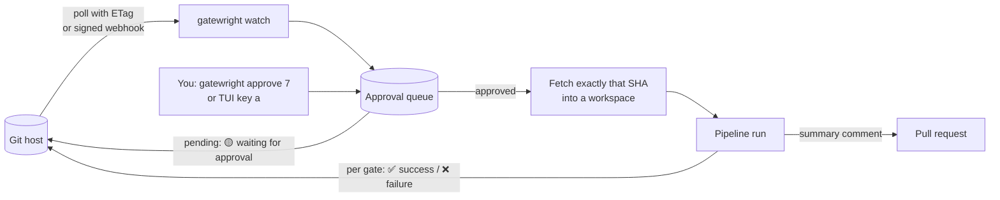

# Git integration (v0.5)

Gatewright can watch your repository on **GitHub**, **Gitea**, **Forgejo** (including Codeberg) or
**GitLab**. When a branch moves or a pull request changes, it queues the commit and waits for your
approval. Then it runs exactly that commit and reports ✅ / ❌ per gate next to the commit and the
pull request.



## Contents
- [Quick setup](#quick-setup)
- [Host-specific setup](#host-specific-setup)
- [Polling or webhooks](#polling-or-webhooks)
- [Trust and approval](#trust-and-approval)
- [Commit statuses and pull requests](#commit-statuses-and-pull-requests)
- [The queue](#the-queue)
- [The pre-push hook](#the-pre-push-hook)
- [How a queued commit is run](#how-a-queued-commit-is-run)

## Quick setup

1. Add a `vcs:` section to `.gatewright/pipeline.yml`:

   ```yaml
   vcs:
     provider: github          # github | gitea | forgejo | gitlab
     repo: you/your-project
     branches: [main]          # globs are fine: [main, "release/*"]
     mode: manual              # manual | auto-trusted | auto
     trusted: [you]            # authors whose (non-fork) pull requests are trusted
   ```

2. Give Gatewright an API token as the secret `VCS_TOKEN`:

   ```bash
   export GATEWRIGHT_SECRET_VCS_TOKEN=...     # or VCS_TOKEN=... in .gatewright/secrets.env
   ```

3. Check and start:

   ```bash
   gatewright doctor          # shows the token, git version, webhook secret
   gatewright watch           # keeps running; Ctrl+C stops after the current run
   ```

4. In another terminal (or the TUI's Queue tab, key `u`):

   ```bash
   gatewright queue           # what's waiting
   gatewright approve 1       # run that commit
   ```

All options are in [configuration.md](configuration.md#vcs).

## Host-specific setup

| Host | `provider` | `api_url` | Token |
|---|---|---|---|
| GitHub.com | `github` | (default `https://api.github.com`) | Fine-grained personal access token for the repository: **Contents: Read**, **Commit statuses: Read and write**, **Pull requests: Read and write** (write only for comments) |
| GitHub Enterprise Server | `github` | `https://github.example.com/api/v3` | Same permissions |
| Gitea / Forgejo / Codeberg | `gitea` or `forgejo` | **required**, e.g. `https://codeberg.org/api/v1` | Access token with **repository: Read and write** (statuses), plus **issue: Read and write** for PR comments |
| GitLab.com / self-managed | `gitlab` | (default `https://gitlab.com/api/v4`) or `https://gitlab.example.com/api/v4` | Project or personal access token with the **api** scope |

`repo` is `owner/name` (GitLab: the full project path, e.g. `group/subgroup/name`). The clone URL is
derived from the API URL. Set `clone_url` to override it, e.g. for an internal mirror.

The token is only sent to the API and to `git fetch`. For git it goes through the environment
(`GIT_CONFIG_*`), never on a command line where other users could see it. This needs **git 2.31+**.

> **Leaving Microsoft entirely?** Forgejo (or Gitea) on your own server plus `gatewright watch`
> on the same or another machine is a complete self-hosted setup. See [tips.md](tips.md).

## Polling or webhooks

**Polling** (default) asks the host every `poll_interval` seconds (default 60, minimum 10) for
branch heads and open pull requests. It uses ETags, so an unchanged repository costs almost nothing.
On GitHub, unchanged answers don't count against the rate limit. Branches with plain names cost one request each;
patterns like `release/*` read the whole branch list. When a host limits requests, polling pauses until the time it names. Polling needs no open ports, which
makes it the right choice for laptops.

**Webhooks** make the host call Gatewright immediately:

```yaml
vcs:
  webhook:
    host: 127.0.0.1        # listen address (put a reverse proxy or tunnel in front)
    port: 8787
    path: /hook
    secret: VCS_WEBHOOK_SECRET   # name of the secret holding the shared webhook secret
```

On the host, create a webhook for **push** and **pull request** (GitLab: *Push events* and
*Merge request events*) pointing at your URL, with the same secret.

| Host | How Gatewright checks the delivery |
|---|---|
| GitHub | `X-Hub-Signature-256` (HMAC-SHA256) |
| Gitea / Forgejo | `X-Gitea-Signature` / `X-Forgejo-Signature` (HMAC-SHA256) |
| GitLab | `X-Gitlab-Token` (shared secret) |

Deliveries with a missing or wrong signature get HTTP 401 and are logged. `GET /health` answers `ok`.
Polling keeps running as a safety net. Webhooks only make reactions faster. To expose the port
safely, see [tips.md](tips.md#receiving-webhooks-on-a-home-machine).

## Trust and approval

Running a commit means running **its code on your machine**, so Gatewright decides per event
whether it is *trusted* and whether it may run without a human:

| Event | Trusted? | Why |
|---|---|---|
| Push to a watched branch | yes | Only people with write access can push |
| Pull request from the same repository, author in `trusted` | yes | You listed them |
| Pull request from the same repository, other author | no | They have write access, but you didn't list them |
| Pull request **from a fork** | **never** | Anyone on the internet can open one |

| `mode` | Runs automatically | Waits for `gatewright approve` |
|---|---|---|
| `manual` (default) | nothing | everything |
| `auto-trusted` | trusted events | untrusted events |
| `auto` | everything except forks | pull requests from forks |

**Untrusted runs** (forks, and PRs by authors not in `trusted`) are limited:

- **No secrets.** Jobs that need one fail with "Secrets are withheld from this run because it is untrusted".
- **Your job definitions, their code.** The jobs come from your local `.gatewright/`, not from the pull
  request. A PR that edits `.gatewright/jobs/*.yml` to run something nasty doesn't get to choose what runs.
- The PR comment says the run was untrusted.

Still read untrusted code before approving it: tests and build scripts are code too. Running jobs in
containers (`image:` with `network: false`) limits what an approved-but-malicious change can do.

## Commit statuses and pull requests

Each gate gets its own status context, `gatewright/<gate>` (change the prefix with `status_prefix`):

| Moment | State | Description |
|---|---|---|
| Queued, waiting | pending | `waiting for approval: gatewright approve 7` |
| Auto-approved | pending | `queued (auto-approved)` |
| Running | pending (GitLab: running) | `running (#7)` |
| Gate passed / warned / skipped | success | `passed`, `passed with warnings (3 issue(s))` |
| Advisory gate failed | success | `advisory gate failed (2 issue(s)), not blocking` |
| Enforced gate failed | failure | `failed: sast, lint (5 issue(s))` |
| Gate not run (blocked) | error | `not run: enforced gate \`commit\` failed` |
| Newer commit arrived | error | `superseded by 1a2b3c4d` |

Make `gatewright/commit` and `gatewright/test` **required status checks** in your branch protection
rules, and nothing can be merged without passing them.

With `comment: true` (default), pull requests get a summary comment: result per gate, the top 5
issues with their plain-language explanation, and a report link if `report_url` is set
(e.g. `https://ci.example.com/runs/{run_id}/report.html` if you publish the artifacts somewhere).

## The queue

```bash
gatewright queue              # pending, approved, running
gatewright queue --all        # including done, rejected, superseded, error
gatewright approve 7          # --by alice to record who
gatewright reject 7 --reason "not ready"
```

In the TUI, `u` opens the Queue tab, `a` approves and `n` rejects the highlighted item. The tab also
shows whether a watcher is running. The queue lives in `.gatewright/gatewright.db`, so the TUI, the
CLI and the watcher can be separate processes.

**Each item is pinned to one commit.** Approving #7 runs exactly its SHA, even if the branch moved
on meanwhile. A newer commit on the same branch or PR marks older *pending* items as `superseded`.

| State | Meaning |
|---|---|
| `pending` | waiting for approval |
| `approved` | the watcher will run it next |
| `running` | being run now |
| `done` | finished; see the run id and result |
| `rejected` | never runs |
| `superseded` | a newer commit replaced it before it ran |
| `error` | could not be fetched or run (the note says why) |

## The pre-push hook

```bash
gatewright hook install              # runs the commit gate before every `git push`
gatewright hook install -g commit,test
gatewright hook status
gatewright hook uninstall
```

If the gate fails, the push is refused. `git push --no-verify` skips the hook once. An existing
pre-push hook is never overwritten silently: `--force` backs it up as `pre-push.before-gatewright`,
and `uninstall` restores it. The hook respects `core.hooksPath` and worktrees.

## How a queued commit is run

1. The watcher claims the oldest approved item (safe with several watchers on one project).
2. It creates `.gatewright/workspaces/<id>-<sha>`, fetches the branch or PR ref, and checks out the commit.
   If the branch moved on, it fetches the commit by SHA. It then verifies `HEAD` is the approved SHA and
   refuses to run anything else.
3. It loads the pipeline: from the commit itself for trusted events (so config changes are tested
   together with the code), or from your local `.gatewright/` for untrusted ones.
4. It runs the selected gates (`vcs.gates`, default: the enabled gates). Run history, artifacts,
   cache and secrets stay in **your** project folder, not in the workspace.
5. It reports statuses per gate, comments on the PR, and deletes the workspace.

Run the watcher as a service so it survives logouts and reboots: [tips.md](tips.md#run-the-watcher-as-a-service).
