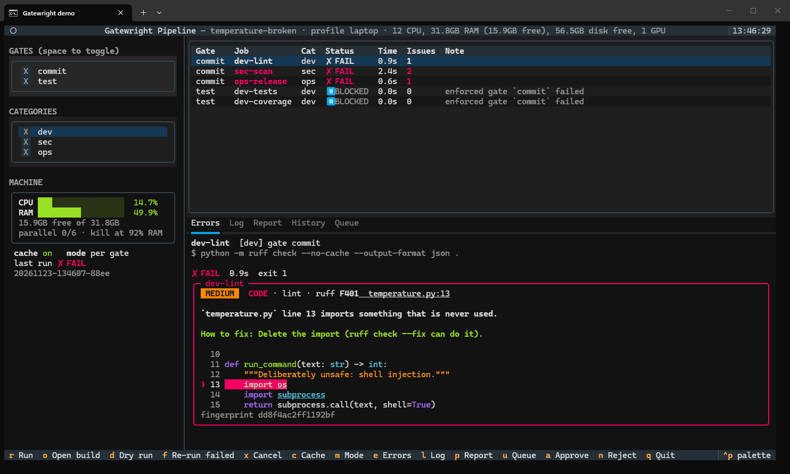

# Gatewright Pipeline

**A self-hosted DevSecOps pipeline for your own laptop or server.** Run Dev, Sec and Ops checks through gates, get
plain-language errors with the failing line marked, and get a verifiable artifact for every run. No cloud, no CI credits.



## Install

```bash
pipx install "gatewright-pipeline[tools]"     # or: pip install, in a virtual environment
gatewright doctor                             # what is missing, and how to install it here
```

Python 3.10 or newer. On Windows also Git for Windows. `[tools]` adds ruff, bandit, pytest, coverage and pip-audit.

## Use

```bash
cd your-project
gatewright init          # starter pipeline for Python, Node or Docker
gatewright run           # or: gatewright tui
gatewright run --local /path/to/build.zip
```

- [Operating Gatewright](https://github.com/TheSamuelAttilaZemes/GateWright-DevSecOps-Pipeline/blob/main/docs/operating.md)
- [Documentation and screenshots of real runs](https://github.com/TheSamuelAttilaZemes/GateWright-DevSecOps-Pipeline#readme)
- [Known issues](https://github.com/TheSamuelAttilaZemes/GateWright-DevSecOps-Pipeline/blob/main/docs/known-issues.md) (this is beta software)

## License

Source-available under the [PolyForm Noncommercial License 1.0.0](https://github.com/TheSamuelAttilaZemes/GateWright-DevSecOps-Pipeline/blob/main/LICENSE.md): **free for noncommercial use**.
Companies and freelancers [need permission](https://github.com/TheSamuelAttilaZemes/GateWright-DevSecOps-Pipeline/blob/main/COMMERCIAL.md).
