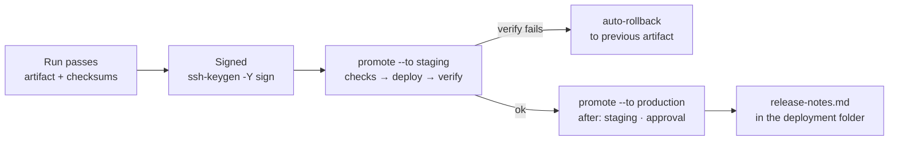

# Signing, deployments and release notes (v0.6)

Once a run has passed, its artifact is what you release. This page covers proving it wasn't changed
(**signing**), moving it through **environments** with **rollback**, and describing it (**release notes**).



## Signing artifacts

Every run already writes `checksums.sha256` (SHA-256 of every file). Signing adds an **SSH signature**
over that file, which ties the whole artifact to a key you control. Gatewright uses `ssh-keygen` from
OpenSSH **8.2 or newer**, which is already on most Linux and macOS machines and on Windows 10/11, so
there's nothing extra to install. The same Ed25519 keys can sign git commits.

### Set up

```bash
gatewright keygen --identity you@example.com --add
```

This creates `~/.config/gatewright/signing_key` (Windows: `%APPDATA%\gatewright\signing_key`)
without a passphrase, so unattended runs can sign. It also adds your public key to
`.gatewright/allowed_signers`. **Commit that file**: it is the list of keys whose signatures you trust.
Then add to `pipeline.yml`:

```yaml
signing:
  key: ~/.config/gatewright/signing_key
  identity: you@example.com
  required: false     # true: doctor treats signing problems as errors, promote requires a signature
```

From now on every run is signed at the end. The run folder gets `checksums.sha256.sig` and
`signature.json` (who signed, key fingerprint, when).

### Verify

```bash
gatewright verify                      # checksums, plus the signature if there is one
gatewright verify --require-signature  # fail if unsigned
gatewright sign <run>                  # sign an older run (only if its checksums still match)
```

| What happened | What `verify` says |
|---|---|
| Nothing changed | `✓ intact` and `✓ Signature: signed by you@example.com` |
| A file was edited | `modified: report.md` |
| A file was edited **and** `checksums.sha256` recomputed | `signature does NOT match: ... changed after signing` |
| Signed by a key that isn't in `allowed_signers` | `the signing key is not in allowed_signers ... not trusted` |
| `signature.json` edited to name someone else | `... the metadata was edited` |
| Not signed | `the artifact is not signed` |

**Protect the private key.** Anyone with it can sign. Keep it only on the machine that runs the
pipeline, readable only by that user (Gatewright creates it with mode 600). Remove a person's line
from `allowed_signers` to stop trusting their key.

## Environments

```yaml
environments:
  staging:
    deploy: ./scripts/deploy.sh staging     # how to deploy
    verify: ./scripts/health.sh staging     # optional check afterwards
    requires: [test]                        # gates that must have passed in the run
    auto_rollback: true                     # verify failed -> redeploy what was there before
    release_notes: true                     # write release-notes.md for each deployment
    secrets: [DEPLOY_TOKEN]
  production:
    deploy: ./scripts/deploy.sh production
    verify: ./scripts/health.sh production
    after: [staging]                        # the same run must be live-tested in staging first
    require_signature: true
    approval: true                          # ask "are you sure?" (or pass --yes)
    auto_rollback: true
```

`deploy` and `verify` run through the normal job runner, with logs, timeout (`timeout`, default
1800 s), secret masking, the job's `shell` and plain-language errors. They get these variables:

| Variable | Value |
|---|---|
| `GATEWRIGHT_ARTIFACT` | The run's artifact folder (manifest, reports, `out/<job>/` files your build put there) |
| `GATEWRIGHT_DEPLOY_RUN_ID` | The run being deployed |
| `GATEWRIGHT_COMMIT` | Its commit |
| `GATEWRIGHT_ENV` | The environment name |
| `GATEWRIGHT_DEPLOY_ID` | The deployment number |

**The same artifact moves from environment to environment.** Deploy what your build job put into
`$GATEWRIGHT_OUT` (for example, a wheel, tarball or image reference), never a fresh build.

### Promote

```bash
gatewright promote --to staging              # the last run
gatewright promote 20261122-091414-b33b --to production --yes
```

Before deploying, Gatewright checks **all** of the following and lists every reason it refuses:

- the run did not fail
- every gate in `requires` passed in that run
- the run was successfully deployed to every environment in `after`
- the artifact still matches its checksums
- the signature is valid and trusted (if `require_signature` or `signing.required`)
- approval: interactive yes/no (`approval: true`), or `--yes`. Without a terminal and without `--yes`,
  it refuses.

### Verify and automatic rollback

After `deploy` succeeds, `verify` runs (if set). If it fails and `auto_rollback` is on, Gatewright
redeploys the artifact that was live before, and verifies that too. The failed deployment is
recorded as `rolled_back` with the reason. Without `auto_rollback` it is `verify_failed`, and the new
(broken) version stays live for you to decide.

### Roll back by hand

```bash
gatewright rollback production              # to the artifact live before the current one
gatewright rollback production --to <run>   # to a specific run
```

Rollbacks still check the artifact's checksums (and signature, if required), but not `requires`/`after`.
That artifact was already approved when it first went out.

### History

```bash
gatewright deployments              # what's live where, and every attempt
gatewright deployments production
```

Each deployment has a folder `.gatewright/deployments/<id>-<env>/` with `deploy.log`, `verify.log`,
`release-notes.md` (if enabled) and, for successful ones, `deployment.json`. The history is in the `deployments` table of `.gatewright/gatewright.db`.

| Status | Meaning |
|---|---|
| `succeeded` | deployed (and verified); this is now live |
| `failed` | `deploy` failed; whatever was live before is still live |
| `verify_failed` | deployed, but `verify` failed and there was no automatic rollback |
| `rolled_back` | deployed, `verify` failed, and the previous artifact was redeployed |

## Release notes

```bash
gatewright release-notes                         # since the last tag, up to HEAD
gatewright release-notes --run last -o NOTES.md  # add the run's quality summary
gatewright release-notes --from v1.2.0 --to v1.3.0 --title "Release 1.3.0"
```

Commits are grouped by [Conventional Commits](https://www.conventionalcommits.org/) prefixes:

| Section | Commit prefixes |
|---|---|
| Breaking changes | `type!:` or a `BREAKING CHANGE` footer |
| Features | `feat:` |
| Fixes | `fix:` |
| Security | `security:`, `sec:` |
| Performance | `perf:` |
| Documentation | `docs:` |
| Maintenance | `refactor:`, `test:`, `build:`, `ci:`, `chore:`, `style:`, `deps:` |
| Other changes | anything else |

With `--run`, a **Quality** section lists the run's result, gates, tests passed/failed, coverage, open
findings by severity, and whether the artifact is signed. With `release_notes: true`, every deployment
writes notes covering the commits since what was live before.
